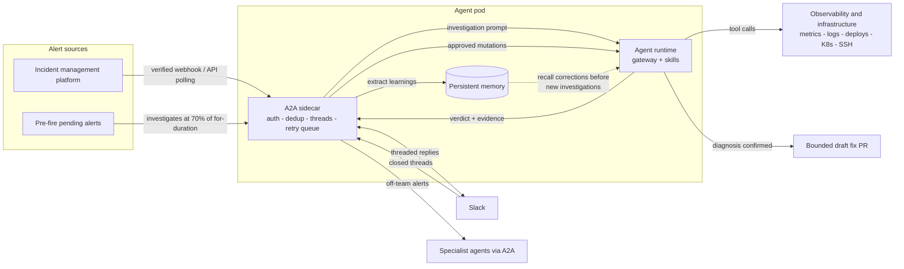

# ai-oncall-agent

> An AI engineer that answers the pager: it investigates production alerts on its own, asks permission before touching anything, and learns from every human correction.

This repository is a **case study — no code** — of a production system I built and maintain: an autonomous on-call assistant for an infrastructure team. It watches the alert channel, investigates firing (and *pre-firing*) alerts with the same tooling a human on-call engineer would reach for, posts structured diagnoses in Slack, and only executes mutating actions after an explicit human approval — captured with Slack buttons and re-verified against live state.

**Status:** production, dev + prod environments, first shipped March 2026, still evolving (v1.14).
**Stack:** [OpenClaw](https://github.com/openclaw/openclaw) (MIT agent gateway) · Python/FastAPI sidecar · SQLite-on-PVC queues · Kubernetes + Kustomize + ArgoCD · Vault · GLM models served through a LiteLLM gateway.

I'm sharing this because the interesting engineering in agent systems is rarely the prompt. It's the **plumbing** (reliability), the **guardrails** (safety), the **feedback loops** (learning), and the **evaluation** (measurement). This case study documents all four, including the war stories.

---

## What it does, end to end

A typical incident:

1. An alert fires. The sidecar receives it (signed webhook or API poll), deduplicates it, and checks whether a *pending* investigation already exists for the same alert — if so, it reuses that Slack thread instead of starting a duplicate.
2. The agent investigates: correlated alerts, recent deployments, service health, metrics, logs, cluster state, host-level diagnostics over zero-trust SSH. Read-only actions are **executed during the investigation**, not recommended for later.
3. It posts a verdict in the alert thread: diagnosis, numbered evidence with sources, confidence, and — only if the fix mutates state — the exact command behind an **Approve / Deny** button.
4. A human approves (first click wins, 24h TTL). The agent **re-verifies the alert is still firing and conditions still hold**, executes, and reports back in-thread.
5. When the thread goes quiet or the alert resolves, the sidecar extracts what the humans corrected and stores it as durable memory — with the original alert and service as tags. Next time that alert fires, the agent recalls the correction *before* investigating from scratch.
6. If the diagnosis is solid and the fix is small, the agent can open a **draft PR** against an explicitly vetted repository — review-only, never merge, never deploy.

## The five pillars

| # | Pillar | What it covers |
|---|--------|----------------|
| 1 | [Architecture](docs/architecture.md) | Why an agent + sidecar split, the skills layer, A2A delegation, config-as-documentation |
| 2 | [Safety model](docs/safety.md) | Act / gate / propose, fail-closed auth, secret hygiene, the "capability ≠ authority" principle |
| 3 | [Learning loop](docs/learning-loop.md) | Pre-fire investigations, human-correction capture, prediction accuracy, self-improvement |
| 4 | [Evaluation](docs/evaluation.md) | Human-labeled cases, group-aware holdout splits, exposure ledgers, DSPy/GEPA optimization |
| 5 | [Operations](docs/operations.md) | Retry queues, concurrency, startup races, timeout tuning, the monolith refactor |

Plus the honest retrospective: [Lessons learned](docs/lessons.md).

## Timeline (real changelog, condensed)

Nine months, one version at a time:

| When | Milestone |
|------|-----------|
| Mar 2026 | v1.0–1.3: agent wired into the alerts Slack channel; threaded replies; Slack channel policy tuning |
| Mar 2026 | v1.4–1.5: ArgoCD + runbook skills; certificate-based reasoning protocol required before any diagnosis |
| Mar 2026 | v1.6: self-improvement skill — the agent can propose PRs to its own configuration |
| Apr–May 2026 | v1.7–1.9: model swaps (GLM-5 → 5.1-FP8) with zero code changes; incident.io MCP skill; SQLite retry queue |
| Aug 2026 | v1.10: **proactive pending-alert investigations** — act before the page |
| Aug 2026 | v1.11: **thread-closure learning** — corrections become durable memory |
| Aug 2026 | v1.12: the 3,300-line sidecar monolith split into a package; workers parallelized with bounded concurrency |
| Ongoing | Slack Block Kit approval buttons, gateway readiness gates, usage-metrics collector, offline evaluation harness |

## Honest limits

Things I'd flag in a design review, that the polished pitch would skip:

- **Evaluation is the frontier, not the prompt.** The eval harness is built and reviewed, but cold-starting it on real incident history is slow and deliberately cautious — a completed run does not equal permission to change production prompts.
- **At-least-once beats at-most-once** for alert delivery. The Slack bridge can, on an ambiguous failure, create a duplicate thread; I chose a rare duplicate over a lost alert. Documented tradeoff, not an accident.
- **Model-generated memory is untrusted input.** Extracted learnings are hypotheses, excluded from evaluation ground truth by design.
- The system is tuned to one team's on-call reality — it generalizes as an architecture, not as a drop-in product.

## About me

I'm **Vítor Andrade** ([@choutos](https://github.com/choutos)) — an infrastructure engineer who ended up building AI systems for the hard part of the job: production operations. My day job is running a platform-infrastructure team's tooling and on-call; this agent is the project where that experience and LLM engineering meet.

I design, build, review, and operate this system end to end: the agent's reasoning protocols, the ingestion sidecar, the deployment manifests, and the evaluation pipeline. Opinions here are my own.

---

*This is a descriptive case study. The production system it describes is real; hostnames, team names, and org-specific details have been generalized, and no source code is published here.*
