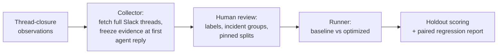

# 4 · Evaluation

Agent changes are terrifying when you can't measure them: a "better prompt" can silently increase wrong-team handoffs or missed escalations. This system's response is a production-grade evaluation harness — built with the same seriousness I'd apply to a payments pipeline, because the blast radius is production infrastructure.

## The decision under test

Not "is the diagnosis good?" (too fuzzy) but a **discrete, reviewable decision**: given the evidence available at investigation time, which team owns this alert, does it need urgent human escalation, and is every cited piece of evidence real?

That decomposition is what makes it evaluable:

- `owner` — one of a small set of routing outcomes, including an explicit `uncertain`
- `decisive_evidence_ids` — which collected observations the decision actually rests on (guards against post-hoc storytelling)
- `urgent_human_escalation` — safety-relevant boolean, weighted heavily in scoring

## The pipeline

1. **Candidate discovery.** The collector lists memory-store observations *only as references* to find historical alert threads, fetches the full Slack thread history (with rate-limit-aware retries honoring `Retry-After`), and freezes a snapshot: the original alert plus every non-agent observation available *before the first agent reply*. Anything learned later is excluded — labels must reflect what was knowable at decision time.

2. **Human review is load-bearing.** Labels require an independent human review pass in a private terminal: reviewer identity, cross-thread incident grouping (so one incident can't straddle two splits), exact candidate digests, and pinned train/val/test partitions. Cases that changed or vanished after review are excluded, not silently re-used. Retrospective memory text is **never** used as a classifier input or as a verified label — the thing the model wrote about an incident is not the ground truth of that incident.

3. **Optimization with discipline.** Baseline and optimized programs run on the *same* student model; the optimizer sees only train/val; the untouched test split is scored once, after compilation. Optimization itself uses DSPy with GEPA (prompt-proposals under a weighted rubric — where the rubric's weights, not GEPA's defaults, define "perfect").

4. **Paired regression reporting.** Aggregate averages hide the two failure modes that actually matter. Reports pair them explicitly: *newly-unsafe handoffs* (off-team ownership assigned without support) and *missed escalations*, even when the mean score improved.

## Holdout discipline

This is where most agent evals quietly cheat, so it's worth being explicit about the rules the harness enforces:

- **Group-aware splits**: every case from the same incident shares one split — no train/test leakage through related threads.
- **Exposure ledger**: each test incident is recorded as exposed *immediately before* scoring begins. A crash before scoring leaves the holdout intact; partial scoring failures retain exposure. A fresh holdout review is required for each release evaluation — no re-scoring a spent test set and calling it validation.
- **Locked ledger state**: partitions and exposure live in a locked, private ledger; concurrent runs serialize on it.
- **Strict staging**: candidates travel as private, mode-0600, single-hard-link, symlink-free files staged in a reviewer-owned directory — checked before consumption. (Yes, for eval input. That's the level of paranoia required when eval data contains real incident details.)
- **Nothing real in Git**: real cases, credentials, and optimized artifacts are Git-ignored; reports go to private destinations only.

## What it is honest about

- **Not a safety proof.** An evidence ID can exist and still be misinterpreted; scores from a rubric don't certify factual reasoning. Safety-relevant disagreements get human review before any production change.
- **Coverage is a subset.** Threads where no human ever participated can't produce correction-based candidates, so evaluation coverage is reported as a subset, never as the on-call population.
- **Promotion is a separate gate.** An improved score earns nothing by itself: optimized prompts reach production only through reviewed PRs, dev shadow validation, and the normal image promotion. The harness informs decisions; it doesn't make them.
- **Cold start is real.** Building reviewed incident history takes time; until then, coverage reports (which don't need labels) are the honest output.

The meta-lesson: building the eval pipeline correctly took longer than building the agent — and it's the component that makes everything else *changeable*.
